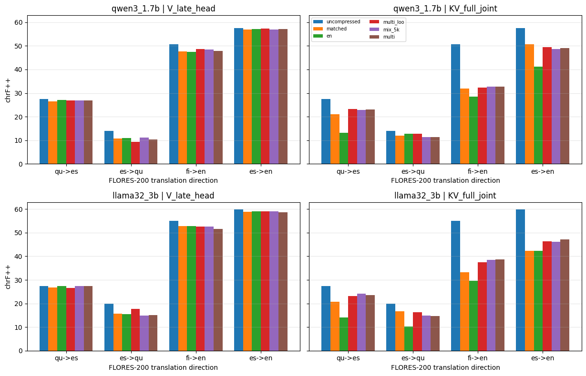
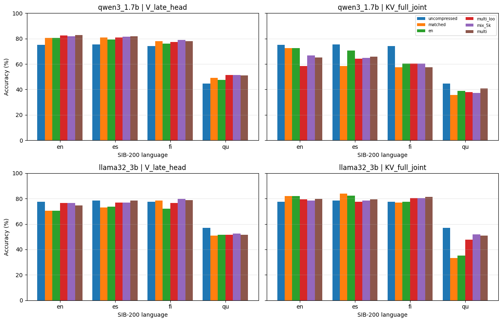

# Cross-Lingual Calibration Bias in Low-Rank KV-Cache Compression for Low-Resource Languages

[](https://doi.org/10.5281/zenodo.24619734)

Systematic empirical study of **low-rank KV-cache compression** across high- and low-resource languages — **English (`en`)**, **Spanish (`es`)**, **Finnish (`fi`)**, and **Ayacucho Quechua (`qu`)** — replicated across two distinct LLM architectures with identical KV-cache geometry (`28` layers, `8` KV heads, `head_dim = 128`, `D_KV = 1024`):
- **`Qwen/Qwen3-1.7B`** (with per-head QK-RMSNorm `k_norm`)
- **`unsloth/Llama-3.2-3B`** (standard attention, no `k_norm`, different tokenizer & pretraining mix)

---

## Core Findings (Replicated Across Both Architectures)

1. **Across the entire network depth, Values (`V`) carry severe cross-lingual calibration bias while Keys (`K`) are nearly language-agnostic (once position 0 is protected).**
   - On strictly parallel **FLORES-200** sentences (`V`, late layers `21–27`, `r = 0.25·d`, `head`, `protect_pos0 = True`), English-only calibration penalizes:
     - **Qwen3-1.7B:** Quechua **`+0.601` nats/tok (`+75.1%` PPL)**, Finnish `+0.141` (`+19.5%`).
     - **Llama-3.2-3B:** Quechua **`+0.524` nats/tok (`+72.1%` PPL)**, Finnish **`+0.601` (`+90.3%` PPL)**, Spanish `+0.217` (`+29.0%`).
   - Across all four depth quartiles (`early 0–6`, `mid1 7–13`, `mid2 14–20`, `late 21–27`, `joint r = 0.25`, `protect_pos0 = True`), `K` stays nearly immune to calibration language in **both** models (`ΔNLL ∈ [-0.010, +0.032]`), while `V` carries massive cross-lingual bias across `early`, `mid2`, and `late`.

2. **Position-0 attention-sink protection (`protect_pos0 = True`) is universally beneficial — and *mandatory* in QK-Norm models.**
   - Even standard full-sequence SVD (`SKIP_FIRST_TOKENS = 0`, `gram_all_proj_all`) fails to preserve `K[0]` because token `0` is only `1/512` of tokens with low pre-norm magnitude (`0.2–0.3×`).
   - **Cross-architecture contrast (`k_norm` amplification):**
     - **Without `k_norm` (Llama-3.2-3B):** standard SVD increases late-layer `K` PPL by `+5.1–10.6%` (`head`) and `+1.7–3.3%` (`joint`); protecting `pos 0` cuts Quechua error `5.5×` (`3.34% → 0.61%` `joint`).
     - **With `k_norm` (Qwen3-1.7B):** QK-RMSNorm re-normalizes the truncated low-norm sink (`0.31× → 1.07×`), amplifying angular distortion (`cos_sim = 0.689`) into a **catastrophic `+153–328%` explosion** under standard SVD — completely eliminated by protecting just **1 token (`pos 0`)** (`→ +1.15–1.99%` pre-`k_norm`, **`-0.37%` to `+0.72%`** post-`k_norm`).

3. **Shared across-head projection (`joint`) cuts cross-lingual loss dramatically at the same rank budget.**
   - Replacing per-head projectors (`r = 32`/head) with a layer-wide projector (`r = 256` across 8 KV heads) reduces the English-calibration penalty on parallel FLORES-200 Quechua from `+0.601 → +0.147` nats/tok on Qwen3-1.7B (`-76%`) and `+0.524 → +0.348` on Llama-3.2-3B (`-34%`), while also lowering matched compression cost to near zero (`-2.2%` on Qwen3, `-0.14%` on Llama-3.2).

4. **Leave-one-out multilingual calibration (`multi_loo`) fails on monolingual PPL — and just ~5k target tokens (`mix_5k`, `w = 0.10`) unlock both 4× full-model PPL and real downstream generation.**
   - Excluding the target language (`multi_loo`) leaves huge penalties on parallel FLORES-200 (`qu`: `+0.556` Qwen3, `+0.487` Llama-3.2 `head`; `fi`: `+0.507` Llama-3.2 `head`).
   - Mixing just **`5k` tokens (~10 windows of 512 tokens)** of the target language at `w = 0.10` into a `joint` projector + `protect_pos0 = True`:
     - **FLORES-200 parallel (`flores_to_flores`, `joint`):** Quechua `ΔNLL = -0.0296` (Qwen3) and **`+0.0022`** (Llama-3.2 — 99.4% gap closed!); Finnish `-0.0003` (Qwen3) and **`+0.0090`** (Llama-3.2 — 98.0% gap closed!).
     - **Cross-domain (`wiki_to_flores`, 5k Wikipedia tokens evaluated on FLORES news):** Quechua `ΔNLL = -0.0086` (Qwen3) and **`+0.0115`** (Llama-3.2 — 96.8% gap closed!).
     - **Full-model 4× `K+V` (`layers 3–27`, 89% of all layers!):** English-only calibration breaks even Spanish (`+428%` Qwen3, `+525%` Llama-3.2), Finnish (`+260%` / `+266%`), and Quechua (`+25%` / `+140%`), while **`joint` + `protect_pos0` + `mix_5k`** eliminates 81–98% of the cross-lingual penalty across all four languages in both models.

5. **Downstream tasks confirm real deployment impact — including language-collapse into English during autoregressive translation (Week 7).**
   - Under mild late-layer compression (`V_late_head`), discriminative accuracy and short MT are mostly resilient (except Llama-3.2 SIB-200 Finnish: `-6.4 pp` under English calibration, recovered to `79.9%` by `mix_5k`).
   - Under realistic **4× full-model `K+V` decoding (`KV_full_joint`, `use_cache=True`)**, English-only calibration causes **literal language-collapse into English** during `qu → es` translation (`chrF++`: `27.5 → 13.3` on Qwen3, `27.5 → 14.0` on Llama-3.2), and drops Llama-3.2 `SIB-200` Quechua accuracy to `35.3%` (and even monolingual `qu` calibration drops to `33.3%` because the prompt is bilingual!).
   - **`mix_5k` (`~5k` Wikipedia tokens, zero-leakage cross-domain)** outperforms *every* monolingual basis on bilingual downstream tasks: restoring `qu → es` to **`22.9` (Qwen3) / `24.1` (Llama-3.2, `+10.1` chrF++ over `en`)**, `fi → en` on Llama-3.2 to **`38.6` (`+9.0` over `en`)**, and Llama-3.2 `SIB-200` Quechua to **`52.0%` (`+18.6 pp` over `matched`)**.

---

## Cross-Architecture Summary: Qwen3-1.7B vs. Llama-3.2-3B

| Metric (`r = 0.25`, `protect_pos0 = True` except K std-SVD row) | Qwen3-1.7B (`k_norm = True`) | Llama-3.2-3B (`k_norm = False`) |
|---|---:|---:|
| **K late (`head`, matched): std SVD (`gram_all`) → `protect_pos0`** | `+153–328%` → **`+1.2–2.0%`** | `+5.1–10.6%` → **`+4.4–4.7%`** |
| **K late (`joint`, `qu` matched): std SVD (`gram_all`) → `protect_pos0`** | `+12.1%` → **`+0.69%`** | `+3.34%` → **`+0.61%`** |
| **Depth sweep `K` max `|ΔNLL|` (`en` vs matched, 4 quartiles)** | `0.032` (language-agnostic) | `0.026` (language-agnostic) |
| **Depth sweep `V` max `ΔNLL` (`en` vs matched, `fi` / `qu`)** | **`+0.446`** / **`+0.225`** | **`+0.370`** / **`+0.235`** |
| **Full-model 4× `K+V` (`layers 3–27`): `en` → `mix_5k` (`ΔNLL`, `es` / `fi` / `qu`)** | `+1.57 / +1.25 / +0.24` → **`+0.04 / +0.04 / +0.02`** | `+1.54 / +1.10 / +0.74` → **`+0.04 / +0.10 / +0.14`** |
| **FLORES-200 parallel (`joint`, `qu`): `en` / `multi_loo` → `mix_5k` (`ΔNLL`)** | `+0.147` / `+0.149` → **`-0.030`** | `+0.348` / `+0.350` → **`+0.002`** |
| **FLORES-200 parallel (`joint`, `fi`): `en` / `multi_loo` → `mix_5k` (`ΔNLL`)** | `+0.107` / `+0.065` → **`-0.000`** | `+0.444` / `+0.463` → **`+0.009`** |
| **Cross-domain `wiki→flores` (`joint`, `qu`): `en` → `mix_5k` (`ΔNLL`)** | `+0.130` → **`-0.009`** | `+0.356` → **`+0.012`** |
| **Downstream MT `qu→es` (`KV_full_joint`, `use_cache=True`): `en` → `mix_5k` (chrF++)** | `13.3` → **`22.9`** *(uncomp. 27.5)* | `14.0` → **`24.1`** *(uncomp. 27.5)* |
| **Downstream SIB-200 `qu` (`KV_full_joint`): `en` / `matched` → `mix_5k` (Acc %)** | `38.7 / 35.8` → `37.3` (`multi 40.7`) | `35.3 / 33.3` → **`52.0%`** *(uncomp. 56.9%)* |

---

## Key Figures

### Downstream Autoregressive Translation (FLORES-200 chrF++) & Topic Classification (SIB-200) (Week 7)



### Cross-Architecture Parallel Control on FLORES-200 (Llama-3.2-3B, Week 6 Part 5)


### Llama-3.2-3B Full-Model 4× `K+V` (`layers 3–27`, Week 6 Part 4)


### K vs V Cross-Lingual Bias Across Depth — Qwen3-1.7B (Week 5b) vs Llama-3.2-3B (Week 6)


### Why Standard SVD Breaks `K` in QK-Norm Models (Qwen3-1.7B, Week 5b Parts 2–3)


---

## Repository Structure

```text
kv-cache-low-resources/
├── README.md
├── requirements.txt
├── .gitignore
├── docs/
│   ├── RESULTS.md                                 # Full quantitative tables across Weeks 1–6 (Qwen3 + Llama-3.2)
│   └── ROADMAP.md                                 # Next experiments (downstream SIB-200 / FLORES translation & paper draft)
├── notebooks/
│   ├── 01_week1_spectra.ipynb                     # Week 1 (Qwen3): Per-head & joint K/V spectra (NER, r90/95/99)
│   ├── 02_week1b_subspace_transfer.ipynb          # Week 1b (Qwen3): Cross-lingual subspace overlap & energy transfer
│   ├── 03_week2_intervention_noise_floor.ipynb    # Week 2 (Qwen3): Held-out splits, forward-pass projection, bootstrap CIs
│   ├── 04_week3_4_multilingual_and_mixtures.ipynb # Weeks 3–4 (Qwen3): multi vs multi_loo, 5k token mixture sweep
│   ├── 05_week5_pos0_and_flores.ipynb             # Week 5 (Qwen3): Position-0 sink control + FLORES-200 parallel control
│   ├── 06_week5b_k_deepdive.ipynb                 # Week 5b (Qwen3): k_norm anatomy, 4-way pos-0, depth bands & full-model K+V
│   ├── 07_week6_llama32_replication.ipynb         # Week 6 (Llama-3.2-3B): Complete cross-architecture replication
│   └── 08_week7_downstream_eval.ipynb             # Week 7 (Qwen3 + Llama-3.2): SIB-200 & FLORES-200 MT (use_cache=True)
└── results/
    └── figures/                                   # All 25 PNG figures extracted from executed notebooks
```

---

## Experimental Timeline & Status

| Notebook | Model | Focus | Status | Runtime (Kaggle T4) |
|---|---|---|---|---|
| [01_week1_spectra.ipynb](notebooks/01_week1_spectra.ipynb) | Qwen3-1.7B | K/V singular spectra, NER, cross-lingual Spearman agreement | Done | CPU / ~10 min GPU |
| [02_week1b_subspace_transfer.ipynb](notebooks/02_week1b_subspace_transfer.ipynb) | Qwen3-1.7B | Subspace overlap & transfer efficiency matrices | Done | ~1 min (CPU) |
| [03_week2_intervention_noise_floor.ipynb](notebooks/03_week2_intervention_noise_floor.ipynb) | Qwen3-1.7B | Forward-pass low-rank projection, held-out noise floor, paired bootstrap | Done | ~62 min |
| [04_week3_4_multilingual_and_mixtures.ipynb](notebooks/04_week3_4_multilingual_and_mixtures.ipynb) | Qwen3-1.7B | `multi` vs `multi_loo`, token budget (`5k/20k/150k`) & mixture weight sweep | Done | ~80 min |
| [05_week5_pos0_and_flores.ipynb](notebooks/05_week5_pos0_and_flores.ipynb) | Qwen3-1.7B | Position-0 sink control (`V` & `K`) + FLORES-200 parallel control | Done | ~58 min |
| [06_week5b_k_deepdive.ipynb](notebooks/06_week5b_k_deepdive.ipynb) | Qwen3-1.7B | `k_norm` cosine distortion, 4-way pos-0 (`std SVD` vs `protect`), depth bands & full-model `K+V` | Done | ~76 min |
| [07_week6_llama32_replication.ipynb](notebooks/07_week6_llama32_replication.ipynb) | Llama-3.2-3B | Full cross-architecture replication (no QK-Norm): spectra, pos-0, depth bands, full-model `K+V`, FLORES-200 | Done | ~91 min |
| [08_week7_downstream_eval.ipynb](notebooks/08_week7_downstream_eval.ipynb) | Qwen3-1.7B + Llama-3.2-3B | Downstream SIB-200 classification & FLORES-200 autoregressive MT (`use_cache=True`) | Done | ~50 min |

---

## Reproducing Experiments

All notebooks are self-contained and designed for **Kaggle GPU T4 ×1 (Internet On)** with no Hugging Face authentication token required. See [docs/RESULTS.md](docs/RESULTS.md) for full numerical tables and [docs/ROADMAP.md](docs/ROADMAP.md) for upcoming downstream evaluation (SIB-200 & FLORES translation).
